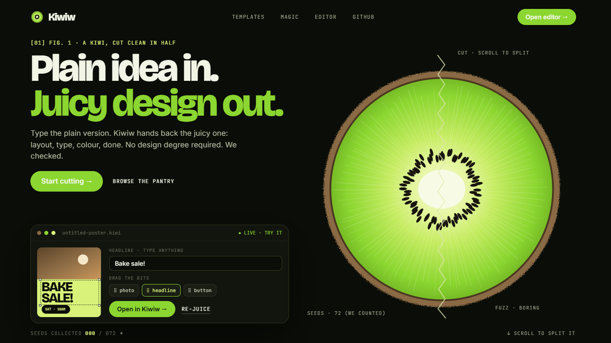
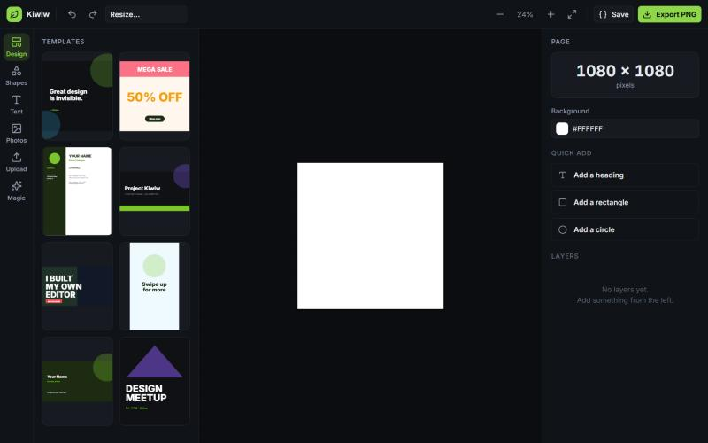
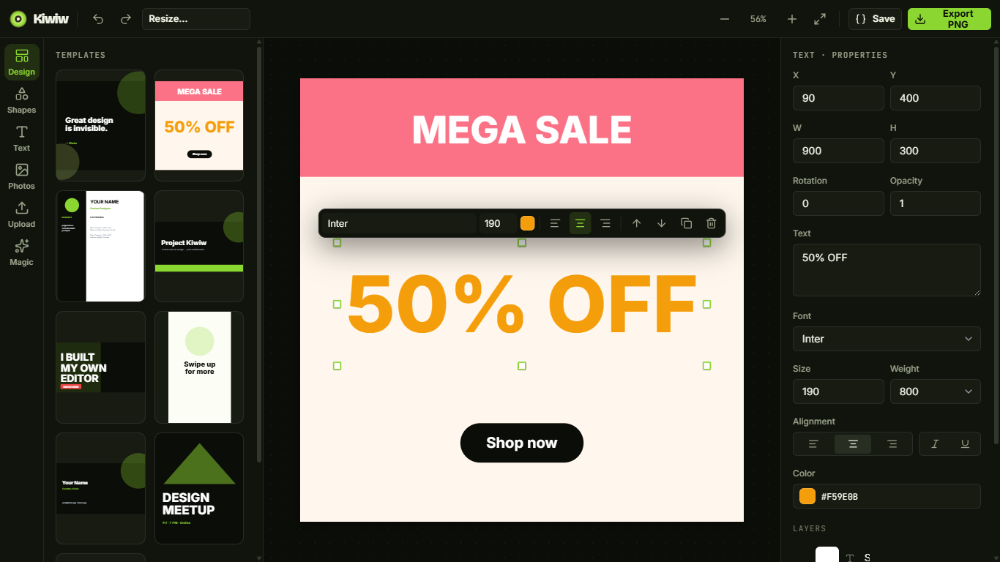
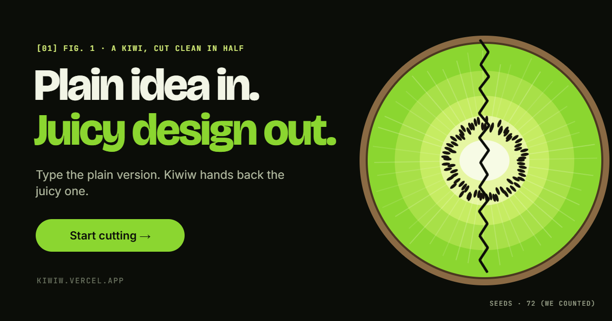

<div align="center">

# Kiwiw

### Plain idea in. Juicy design out.

A browser design studio built around one idea: a kiwi is dull brown fuzz on the
outside and electric green inside. Drag-and-drop editing, real templates and an
AI **Magic Studio**, all client-side. Inspired by the category (Canva, Figma,
Adobe Express); every line is written from scratch.

**[▶ Live demo](https://kiwiw.vercel.app)** · [Report a bug](https://github.com/KASHITOp/kiwiw/issues)




</div>

---

## What is Kiwiw?

Kiwiw is a web app for making graphics — social posts, slides, resumes, posters,
thumbnails and more. Start from a template or a blank canvas, drop in text,
shapes and images, arrange them freely, and export a finished design. An AI
Magic Studio helps you write copy, generate images and clean up photos.

Everything runs client-side, and the AI features work in **demo mode with no API
keys** — add your own keys to go live.

## Screenshots

| Landing hero (scroll splits the kiwi) | Template picker |
| --- | --- |
|  |  |

| Editor with a selected element | Exported PNG |
| --- | --- |
|  |  |

The link-preview card below is itself a Kiwiw template ("Share Card"), exported
with the editor's own PNG pipeline and served as the site's `og:image`.



## Design system

Every visual decision lives in **[DESIGN.md](DESIGN.md)**: palette, the three
type roles (Bricolage Grotesque, Inter, JetBrains Mono), the cut and seed
motifs, labels and grain, components, motion rules and a strict list of don'ts.
The hero's scroll scene, the template marquee and the three Magic demos are all
built to it.

## Features

**Editor**
- Add text, shapes (rectangle / circle / triangle / line) and images
- Drag to move, 8-handle resize, free rotate
- Layers panel — reorder (drag), show/hide, lock, delete, live thumbnails
- Floating contextual toolbar on the selected element
- Properties panel — position, size, rotation, opacity, font, color, fills, radius
- Undo / redo (`Ctrl+Z` / `Ctrl+Y`), duplicate (`Ctrl+D`), delete
- Zoom + Fit, document resize presets
- Export **PNG** (2×) and save/reload projects as **JSON**

**Content**
- 8 original starter templates across Social, Documents, Presentation, Branding and Marketing
- Template engine reads designs as plain data, so thousands can be added without code changes
- Built-in photo search (free demo photos, real Pexels search with a key)
- Upload your own images

**Magic Studio (AI)**
- **Magic Write**: generate, rephrase, shorten or expand copy
- **Magic Media**: turn a text prompt into an image
- **Background Remover**: knock out an image background
- **Magic Resize**: in the oven (shown as a concept demo on the landing page)

Every AI feature runs in **demo mode** with no key, and goes **live** when you add an API key.

## Tech stack

- **React 19** + **TypeScript**
- **Vite** (dev server + build)
- **Zustand** for state (with an undo/redo history stack)
- **React Router** for landing / editor routes
- **lucide-react** icons · **html-to-image** PNG export · **@fontsource/inter**
- A design-token-driven custom CSS system (no UI framework)

## Run it

```bash
npm install
npm run dev
```

Open http://localhost:5173. Build for production with `npm run build`.

## Going live (API keys)

Copy `.env.example` to `.env` and fill in whichever you want:

| Variable | Powers | Get it |
| --- | --- | --- |
| `VITE_OPENAI_API_KEY` | Magic Write + Magic Media | platform.openai.com |
| `VITE_REMOVEBG_API_KEY` | Background Remover | remove.bg/api |
| `VITE_PEXELS_API_KEY` | Real photo search | pexels.com/api |

> ⚠️ Vite exposes `VITE_*` variables to the browser — fine for local development.
> For production, proxy these calls through your own backend so keys are never
> shipped to end users. `.env` is git-ignored and must never be committed.

## Project layout

```
src/
  pages/        Landing.tsx, Editor.tsx
  editor/       Canvas, LeftPanel, PropertiesPanel, LayersPanel, FloatingToolbar,
                AIPanel, AssetPanel, Thumb, ElementContent
  data/         factory.ts (element defaults), templates.ts (seed templates)
  ai/           provider.ts (AI layer: real calls + mock fallbacks)
  store.ts      Zustand store with undo/redo history
  tokens.css    design tokens · styles.css design system
```

## License

[MIT](LICENSE). Third-party dependency licenses are listed in [LICENSES.md](LICENSES.md).

---

Built with [Claude Code](https://claude.com/claude-code).
