# Kiwiw `juice-v2` — overnight REVIEW

Branch: `juice-v2` (main and production untouched).
Preview: **https://kiwiw-46e7wrgon-kartavyaas-projects.vercel.app**
(Vercel protects previews on the hobby plan, so log in to Vercel to view it. Production at kiwiw.vercel.app is unchanged.)

> Status: all six phases done and committed (one commit per phase). Typecheck and build pass. Zero console errors at 1366×768, 1920×1080 and 390px.

## What got built

### Phase 0 · References
`REFERENCES.md`: six original style directions (Block Capitals, The Sunday Issue, Cut & Paste Club, Bombay Talkies Press, Quiet Money, Brainrot Broadcast). Each has type roles (shout / talk / label), palette, depth rule, layout rules, a signature move, a never-rule and a joke. Structure lessons came from the Framer, Clay, Nike, The Verge and Spotify breakdowns on getdesign.md (rigor only, not looks).

### Phase 1 · Type + shape kit
- **18 Google Fonts** self-hosted via Fontsource, grouped by mood (Display · loud, Serif · fancy, Hand · human, Desi · apna, Mono · nerdy, Clean · plain). The picker previews every face in itself and snaps weight to weights the face really ships.
- **11 text presets**: Shouty headline, Fancy serif, Sticker label, Handwritten note, Hinglish caption, Desi headline, Meme caption, Arched badge, Hard shadow pop, Mono label, Body.
- **50 original SVG stickers** in 11 categories (blobs, bursts, badges, scribbles, arrows, tape & paper, bubbles, lines, texture, kiwi, desi), searchable, three recolourable slots, flip.
- **Text effects**: outline, hard shadow, highlight, curved text, ALL CAPS toggle.

| Stickers | Font picker |
| --- | --- |
| 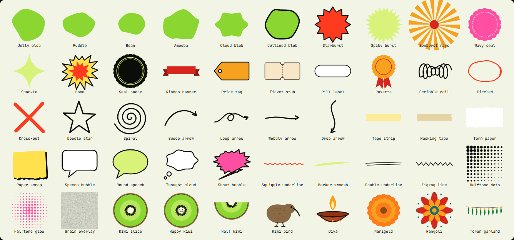 | 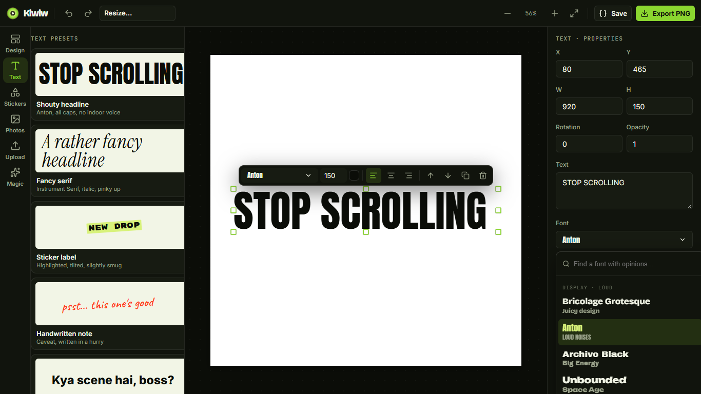 |

### Phase 2 · 24 templates
Four per direction across Instagram post, story, poster, YouTube thumbnail, slide and LinkedIn banner. Each has a funny name and a one-liner on hover. The **Desi pack** has Hinglish copy: Fest Poster That Actually Gets Crowd, Chai Break Menu, Diwali Sale But Make It Fashion, Shaadi Save-the-Date (Mummy Approved), and Investor Bait.

Quality gate: every template was rendered at native size and critiqued; 11 needed fixes (collisions, wrapping, overflow). After fixes none looked generic, so none were deleted. The old 9 templates were removed.

**Best 8:**

| | | | |
| --- | --- | --- | --- |
| 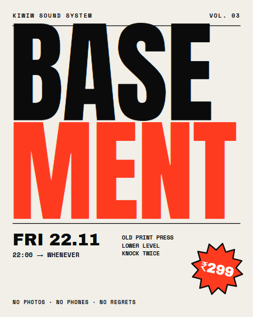 | 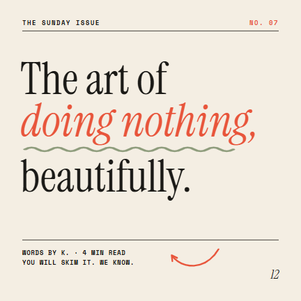 | 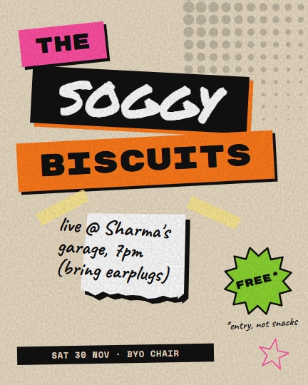 | 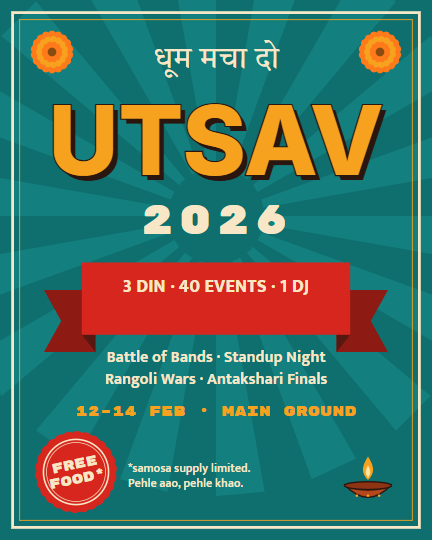 |
| Basement Rave Poster | Long Read, Short Attention | Garage Band Gig | Fest Poster That Actually Gets Crowd |
| 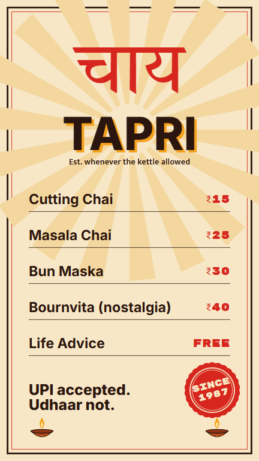 | 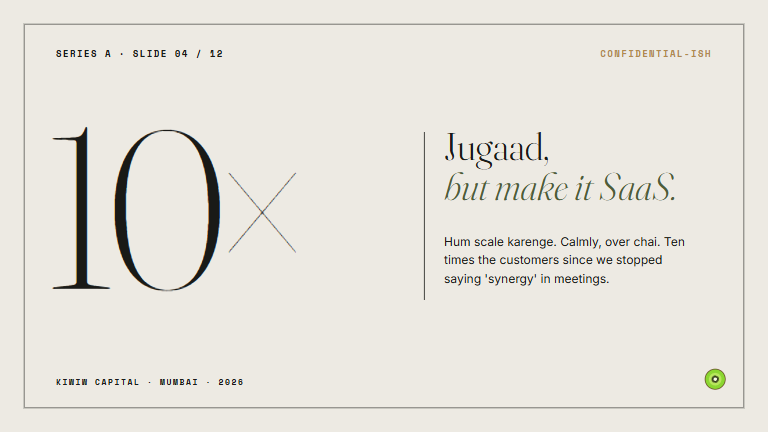 | 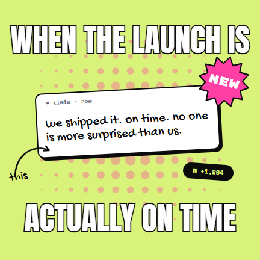 | 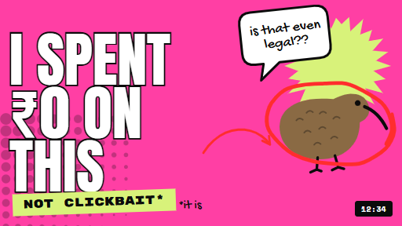 |
| Chai Break Menu | Investor Bait | Ratio'd Announcement | Clickbait But Honest |

### Phase 3 · Juice It
One input, six posters, no API key. The parser splits the line into headline, day, date, time, place and price. Each style has built-in witty copy, and a deterministic layout fits every headline by measuring the real web font. With `VITE_OPENAI_API_KEY` the copy is rewritten by AI first. The reveal splits a kiwi open and the posters fly out of the cut. Clicking one opens it in the editor. It replaces the mini-editor in the landing hero and has its own tab in the editor.

**"bake sale saturday 10am":**

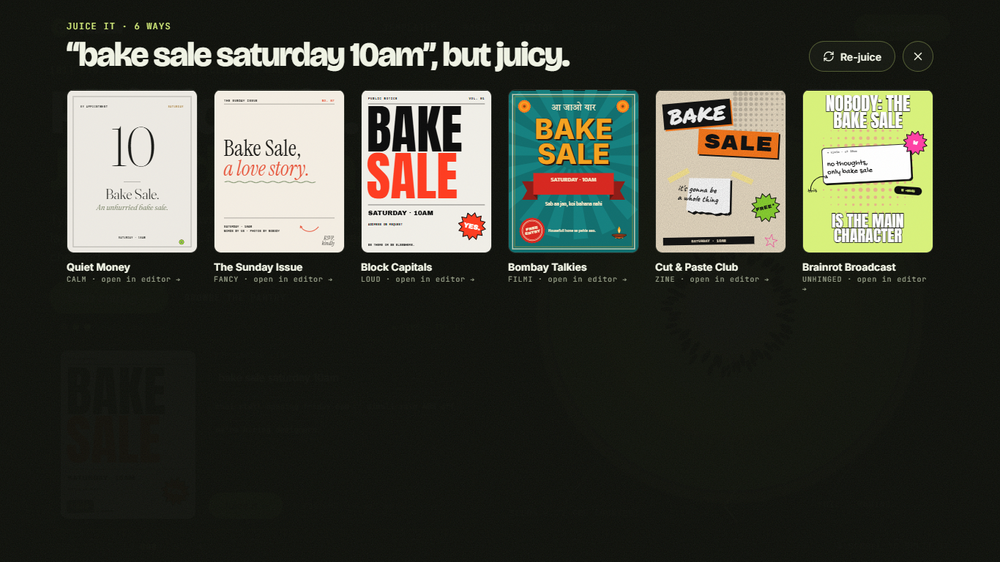

| Mid-burst | Picked → editor |
| --- | --- |
| 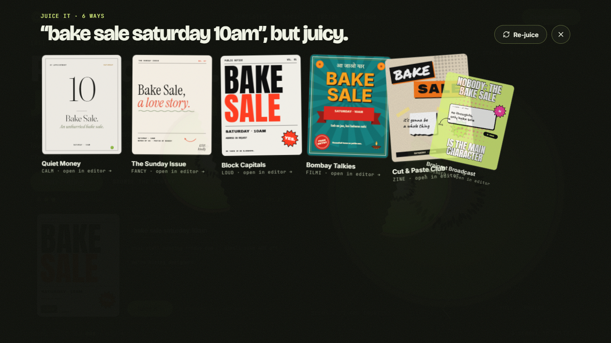 | 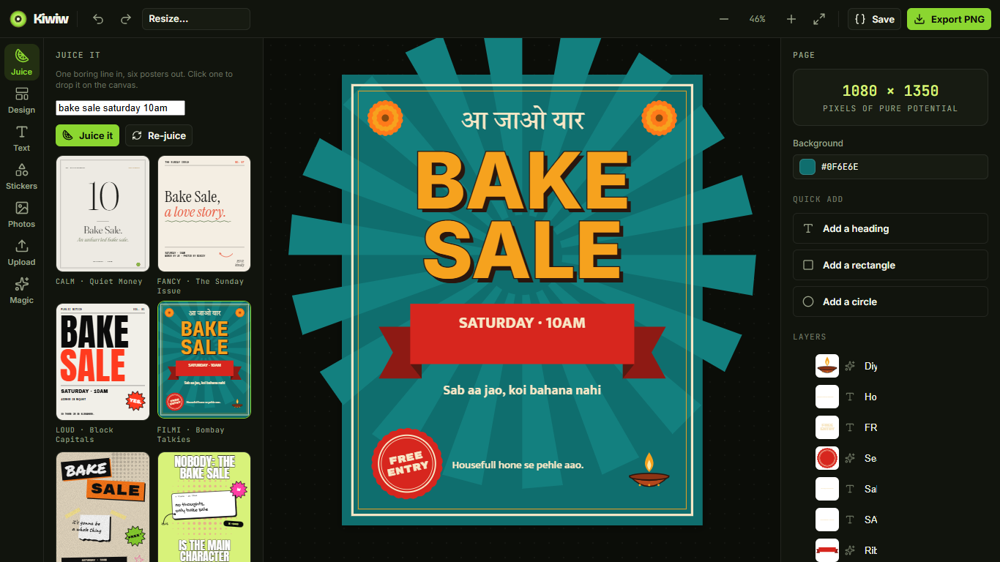 |

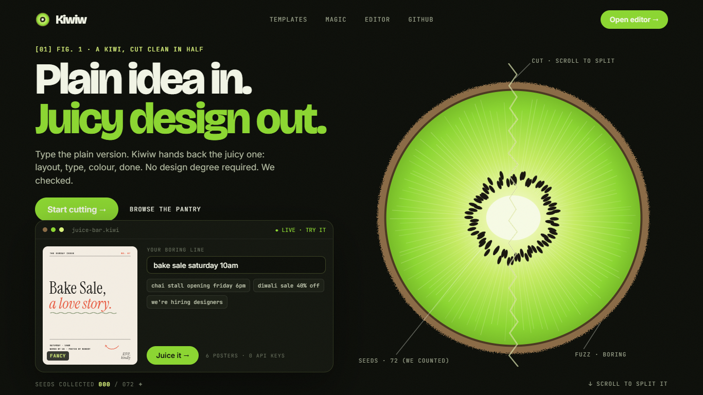

### Phase 4 · Personality
- **Vibe slider** in the top bar: Corporate · Polished · Neutral · Spicy · Unhinged. It rewrites the headline and sub line with prewritten tone lines ("Utsav: A Strategic Update", "UTSAV OR PERISH", "Per My Last Email: …"), swaps the headline font, refits the copy with real font metrics, straightens or tilts everything, and fades or adds chaos stickers. **Neutral is always the untouched original.** Double-click the slider to snap back.
- **Roast My Design**: 9 rules (too many fonts, low contrast, cramped margins, everything centred, microscopic text, no hierarchy, wall of text, lost elements, colour overload). Each roast has a one-click **Fix it**, plus **Fix all**, a 0–100 score and a verdict ("Freshly squeezed" down to "Kiwi-adjacent"). With an OpenAI key, "Extra crispy (AI)" adds a bonus roast.
- **Microcopy**: toasts for export ("Exported. It's juicy."), save, copy and group; errors say what broke, then the joke ("Export tripped over a seed. Try again?"); empty canvas ("A blank page is just a poster with stage fright."); empty layers; tooltips.
- **Easter eggs**: ↑↑↓↓←→←→BA squeezes every kiwi (landing hero, logo, mascot). The kiwi mascot in the editor corner reacts to Comic-Sans-energy fonts ("Comic Sans energy detected. Respect."), vibe changes, roasts and exports. Click it for the seed counter, which has milestones at 1, 10, 25, 50 and 100.

| Roast | Vibe: Unhinged | Vibe: Corporate |
| --- | --- | --- |
| 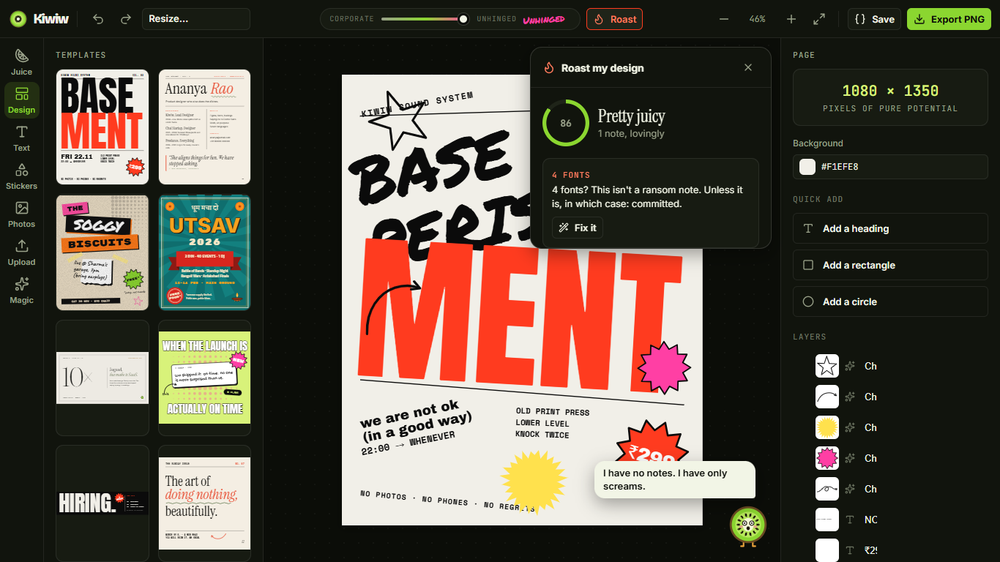 | 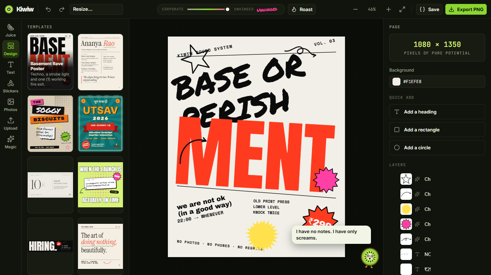 | 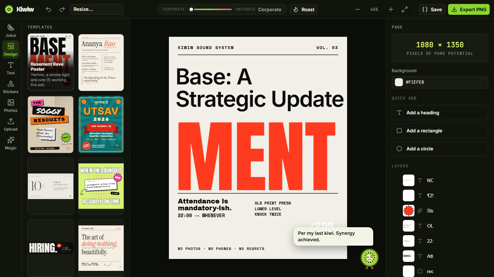 |

### Phase 5 · Editor mechanics
- **Smart snapping** to page and element edges and centres (pink `#FF3D9A` guides) and **equal spacing** (lime `#D8F27A` guides with gap ticks), within 6 screen px. Alt drags freely; Shift-rotate snaps to 15°.
- **Multi-select**: shift-click, marquee drag on empty canvas, dashed group box, everything moves together. **Groups** with Ctrl+G / Ctrl+Shift+G.
- **Shortcuts**: Ctrl+D, arrows (Shift = 10px), Delete, Ctrl+G, Ctrl+C/X/V, Ctrl+Z/Y, Ctrl+A, Esc, `/` jumps to sticker search, `?` opens a cheat sheet.
- **Autosave** to localStorage 600ms after every change; **My designs** grid at the top of the Design tab (thumbnails, "Editing now", delete). Opening /editor empty restores your last design ("Welcome back. Your design waited for you.").

| Snapping guide while dragging | Marquee → group → nudge |
| --- | --- |
| 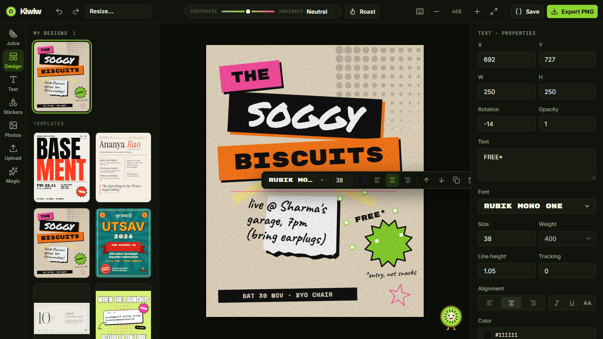 | 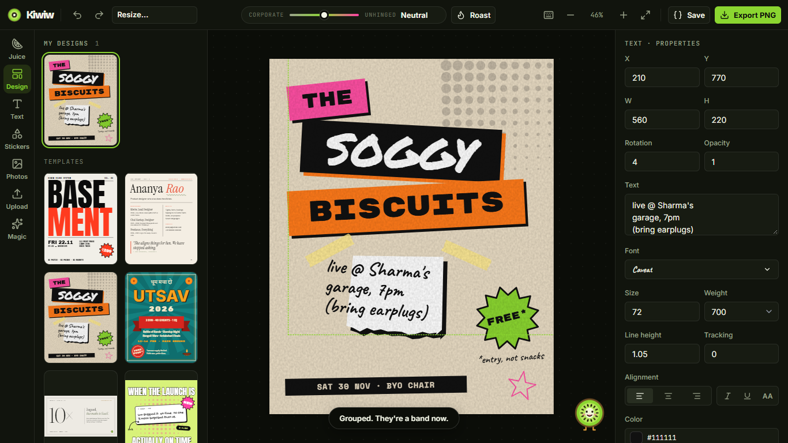 |

| Cheat sheet | My designs + restore |
| --- | --- |
| 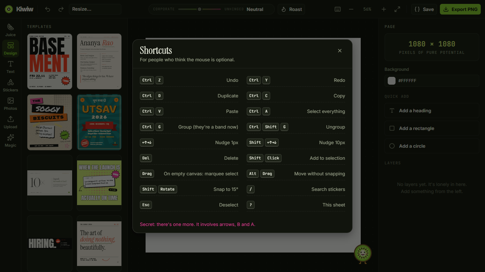 | 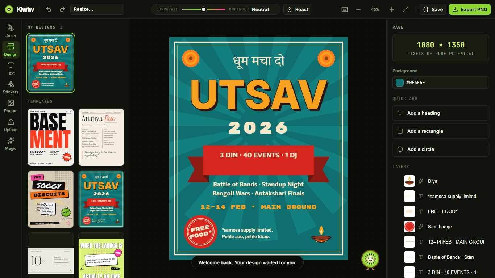 |

### Phase 6 · Verification
- `tsc` clean, `npm run build` exit 0.
- Headless Chrome against the production build: landing, Juice It overlay and editor (with Vibe + Roast open) at 1366×768, 1920×1080 and 390px. **0 console errors, 0 warnings.**
- Preview deployed (no `--prod`). Production at kiwiw.vercel.app is unchanged; main is untouched.

| Phone: Juice It | Phone: editor gate |
| --- | --- |
| 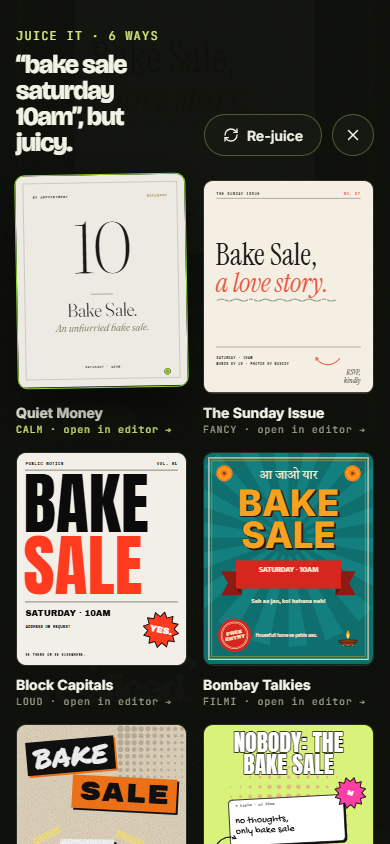 | 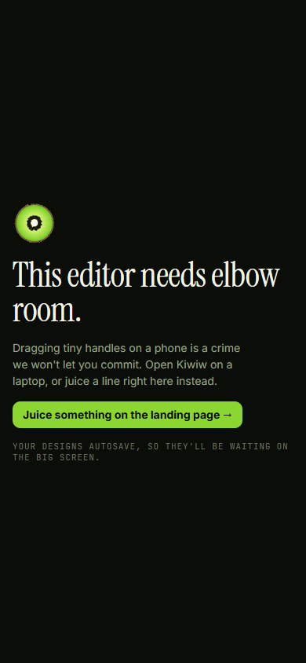 |

## Bold calls I made while you slept
- **No stock photos in templates.** Every image is drawn or typographic. That keeps them original and export-safe; Pexels is still available in the editor's Photos tab.
- **Magic Resize stays "in the oven"** on the landing, because the editor still can't do it.
- **Template order interleaves the six directions**, so no two neighbouring tiles share a style.
- **The hero's mini-editor became Juice It**, because Juice It is the better demo, and the seed animation now flies into its live poster.
- **The editor refuses phones.** Under 760px it shows "This editor needs elbow room." and points to Juice It, which works fine on a phone. That's better than a broken canvas in someone's LinkedIn feed.
- **Vibe edits are throwaway until you touch something.** Edit the design while on Spicy and that edit becomes the new Neutral. That's simpler than a merge, and Ctrl+Z still walks back through it.
- **Full-page textures (grain, halftone) are click-through.** They sat on top and ate every drag. Select them from Layers.
- **The Konami toast says "No refunds."** instead of promising seeds it doesn't give.

## Unfinished / rough edges
- Vibe uses one headline and one sub line per design. Templates that split a headline over two text boxes (BASE / MENT) only rewrite the first half, which is funny on Unhinged ("BASE OR PERISH / MENT") but not intentional.
- Snapping and the marquee use unrotated boxes, so rotated elements snap by their pre-rotation bounds.
- Resize handles only appear for a single element; there's no group resize yet.
- Autosave lives in localStorage. Big uploaded photos can fill it; when they do, a toast tells you to hit Save.
- The AI bonus roast and AI Juice copy are untested without a key (the code paths are there, gated on `VITE_OPENAI_API_KEY`).
- The Vercel preview is behind Vercel login (hobby plan protection).

## Top 5 next ideas
1. **Record mode**: one button that plays a scripted demo (type a line → Juice → pick → Unhinged → Roast → Fix all → Export) at a steady pace, made for the LinkedIn screen recording.
2. **Vibe for Juice It**: drag the slider in the Juice overlay and watch all six posters change at once.
3. **Roast leaderboard / share card**: export the roast score card as an image ("My poster scored 34. Kiwi-adjacent.").
4. **Magic Resize for real**: reflow one design to post, story and banner using the same `fitText` + layout roles Juice It already uses.
5. **Brand kit from a photo**: pick a palette and font pair from an uploaded image, then apply it to any template in one click.

---

# Round 3: Style DNA, effects engine, Juice It 2.0 (overnight, 3 Nov)

Preview: **https://kiwiw-46e7wrgon-kartavyaas-projects.vercel.app** (Vercel preview, behind login; production untouched, main untouched).

## Phase 1 · Style DNA
`STYLE_DNA.md` defines 10 recipes taken from your board: **Nazar Battu, Tapri Print, Stadium Halftone, Brutal Grid, Swiss Drop, Trippy Window, Neo Brutal Pop, 8-Bit Flex, Sticker Bomb, Glossy Bloom**. Each recipe has a palette, a font pairing, a layout grammar, effects, stickers, a copy tone, 3 headlines and a never-rule. I borrowed techniques only: no celebrity, club, car brand, soft-drink brand or character from the board appears anywhere. Photos are 29 Pexels shots, bundled and credited in LICENSES.md. Six new Google Fonts: Rozha One, Yatra One, Khand, Press Start 2P, Shrikhand, Bagel Fat One.

The Pinterest link couldn't be fetched (the scraper refuses Pinterest), so I worked from your written summary plus the board screenshots you pasted.

## Phase 2 · Effects engine
- **Image effects:** halftone (dot size, can invert), duotone, posterize and B&W punch. They render on a canvas and are cached, so exports match the screen.
- **Frames:** postage stamp with real perforations, torn paper, polaroid, retro OS window, truck-art border and evil-eye ring.
- **Finish:** a sticker cutout border and paper grain clipped to the element.
- **Type:** wave (safe for Devanagari matras), arch, outline + hard shadow, stacked caps, glossy bubble, and Devanagari display faces.
- **Backgrounds:** warped checkerboard, psychedelic swirl, halftone gradient, sunburst and pixel grid.
- **Right panel:** an Effects gallery where every tile is a live render of *your selected element* with that effect applied. Page backgrounds appear when nothing is selected.

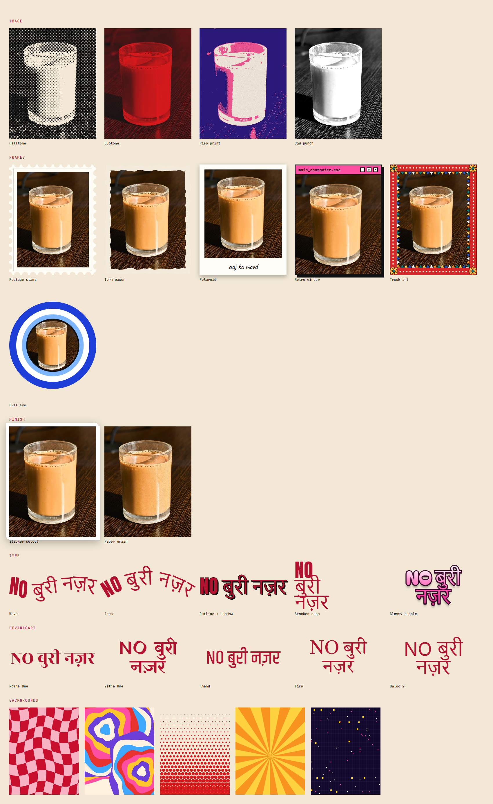
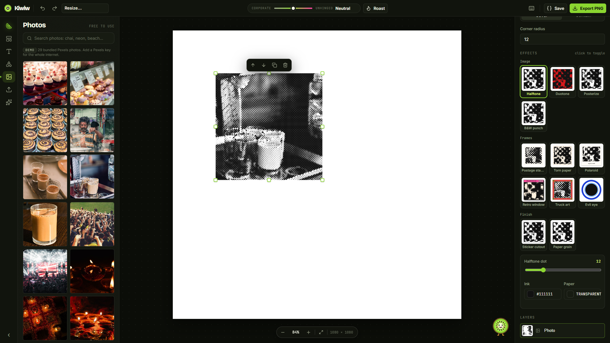

## Phase 3 · Juice It 2.0
- **30 layouts:** each recipe has 3 layout grammars, built on the effects engine.
- **One juice:** you get 6 *different* recipes.
- **No repeats:** the session tracks every recipe+layout it has shown. **Re-juice all** brings unseen recipes first and never repeats a combination.
- **Per card:** **Open** · **Re-juice** (a different recipe in that slot) · **More like this** (same recipe, with a new layout, photo and copy angle). Each card shows the recipe name and a one-line joke.
- **Copy without an API:** banks for 10 topics, with Hindi and Hinglish lines ("BAKED. NOT HALF-BAKED.", "गरम गरम", "Diet kal se, cake aaj se", "नौकरी हाज़िर है"). With an OpenAI key, the AI rewrites the copy in each recipe's tone.
- **Photos:** picked from the bundled Pexels set by keyword, with the recipe's effect applied.

**Quality gate: 49/60 post-worthy.** I ran the 10 test lines through 4 critique-and-fix rounds. Sheets: `docs/review/juice-gate/q00…q09.jpg`. The 11 that still fail:
- Swiss Drop layout 1 with long words ("STARTUP", "DIWALI"): the cropped letters turn into a jumble (2).
- 8-Bit Flex layout 3: the headline stays small for long topics (2).
- Trippy Window layout 3: the top half feels empty when the headline is short (2).
- Stadium Halftone layout 3: the inverted halftone reads as noise on dark photos (2).
- Glossy Bloom layout 1: the paragraph is cramped on long lines (1).
- Brutal Grid layout 2: the photo crop is weak on landscape photos (1).
- Neo Brutal Pop layout 2: the small photo is posterized into mush (1).

**12 best results:**
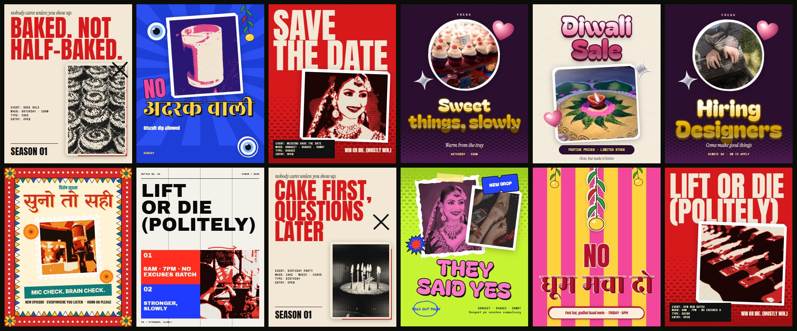

| Overlay | Re-juice all (new recipes) |
| --- | --- |
| 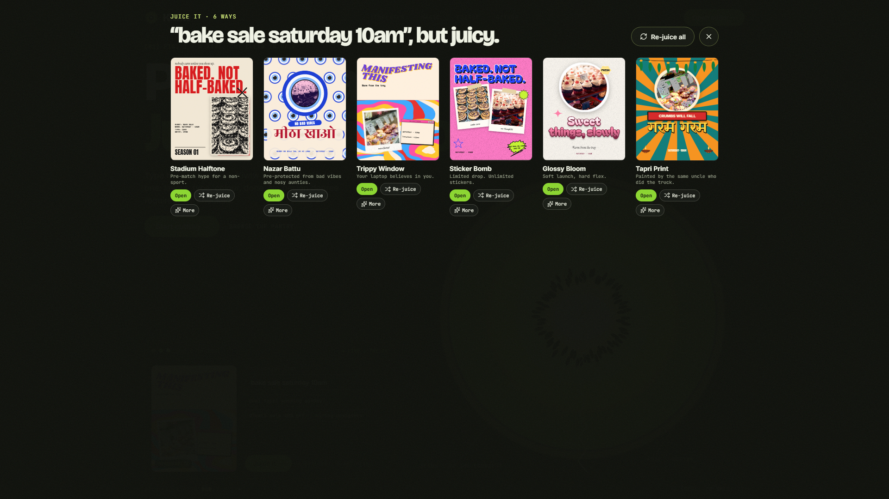 | 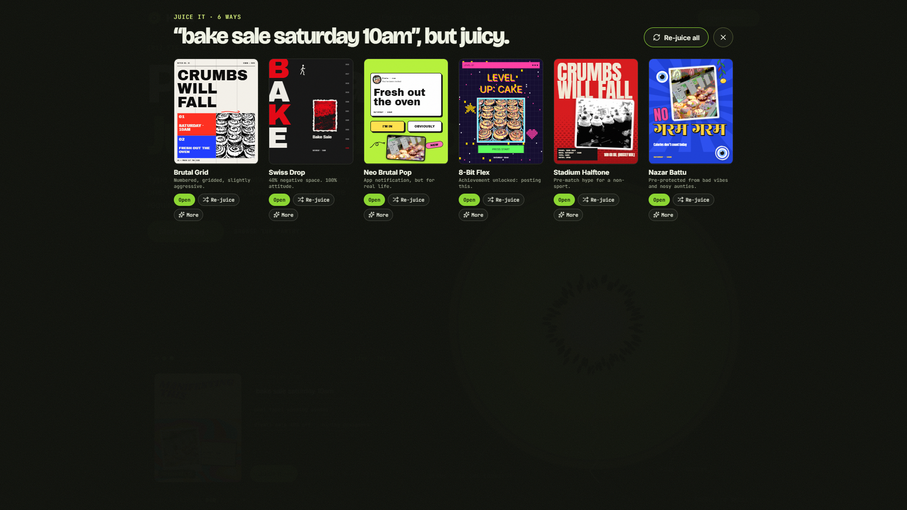 |

## Phase 4 · 20 hero templates
There are 2 heroes per recipe. One is a poster from a Juice layout with curated copy. The other is hand-built as a story, post, YouTube thumbnail or LinkedIn banner. Every hero uses at least 2 effects. They're built with real font metrics and frozen to `heroes.json`. **16 of the old 24 templates were retired** because they looked flat next to these. The 8 I kept are Basement Rave, Long Read, Garage Gig, Fest Poster, Chai Menu, Investor Bait, Clickbait But Honest and the Résumé, which is the only one in the Resumes category. That leaves 28 templates.

**Best 8 heroes:** Nimbu Mirchi Fest Poster, Tapri Rate List, Nazar Na Lage Story, Shaadi Soft Launch, main_character.exe, Bake Sale Limited Drop, Open To Work Loudly, Boss Fight: My Inbox.

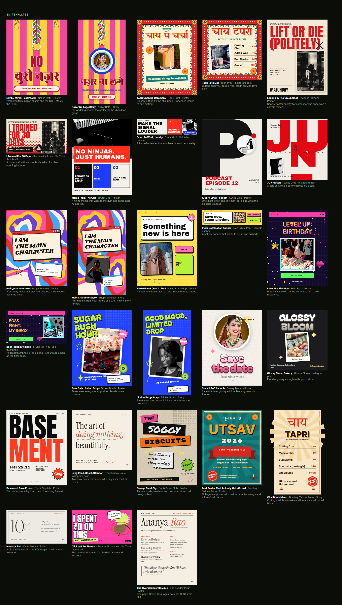
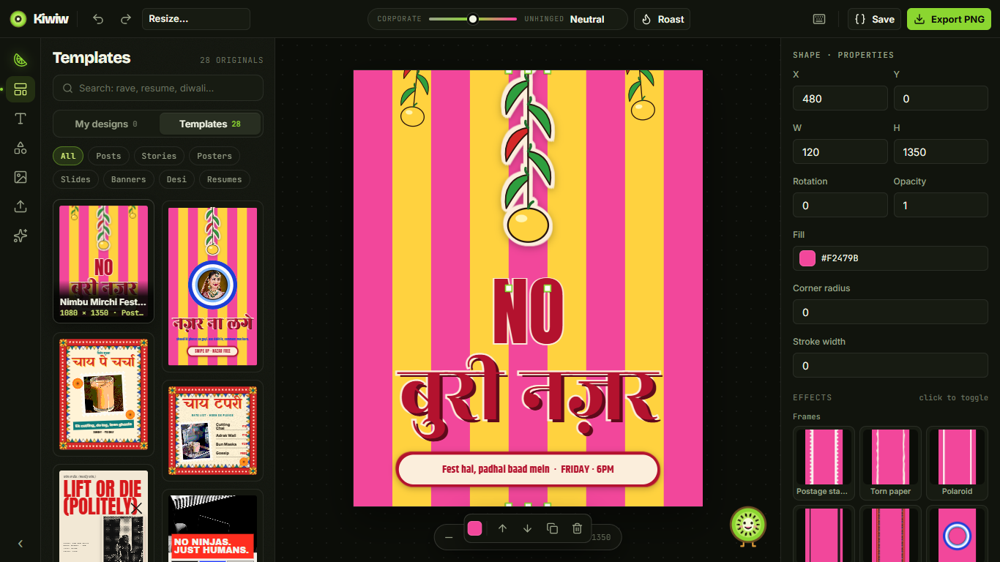

## Phase 5 · Landing v3
- **Style DNA wall:** 10 giant recipe cards, each with its display face, palette dots and joke. Hover a card to see *your* line rendered in that recipe live, from a line you type above the wall.
- **Before/after slider:** a Times New Roman flyer ("[clip art not found]") against the Sticker Bomb version of the same line.
- **Template wall:** tilted 6°, draggable sideways, and infinite (it wraps), with drag-vs-click protection.
- **Section numbers:** renumbered [01]–[06].

| Style DNA wall | Before / after | Template wall |
| --- | --- | --- |
| 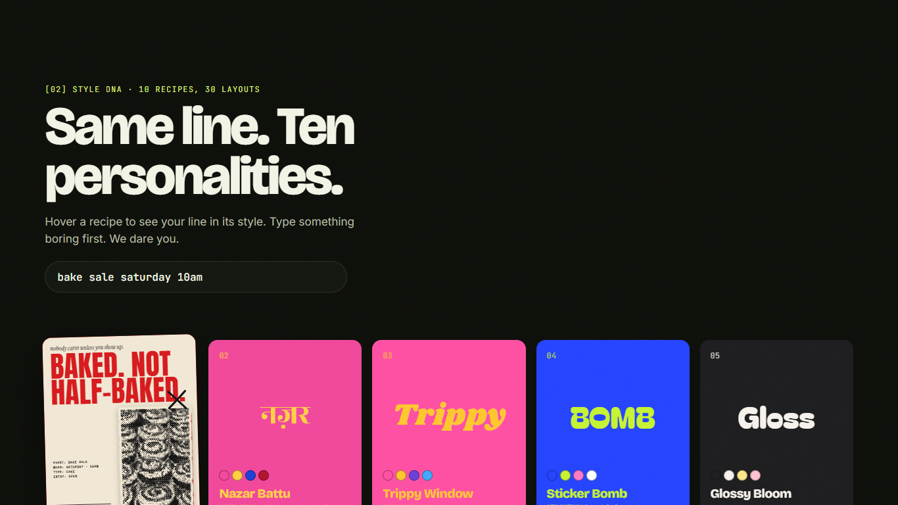 | 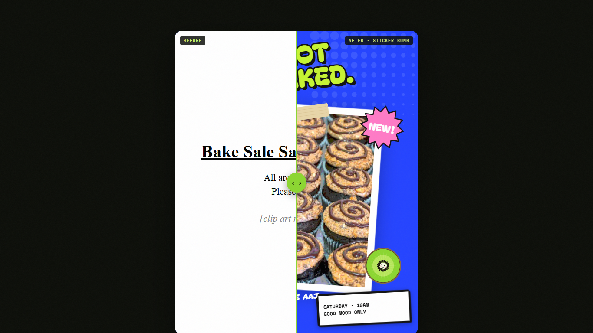 | 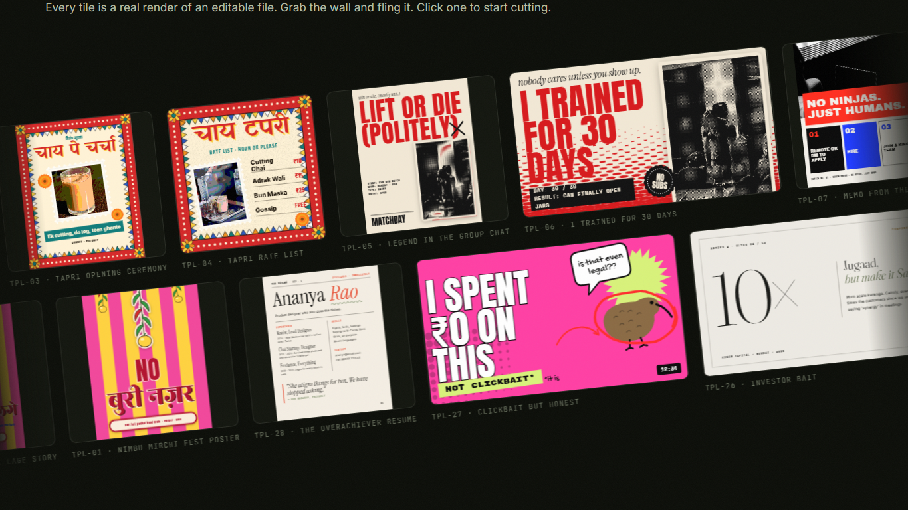 |

## Phase 6 · Editor chrome
This was done in the previous run: 56px rail, tabs, chips, masonry cards, page shadow, zoom pill, real layer thumbnails and human names. I re-verified it here.

## Phase 7 · Verification
- `tsc` is clean and `npm run build` exits 0.
- I tested the production build in headless Chrome: landing page, Juice overlay and editor (with a hero template and an element selected) at 1366×768, 1920×1080 and 390px. **0 console errors and 0 warnings.**

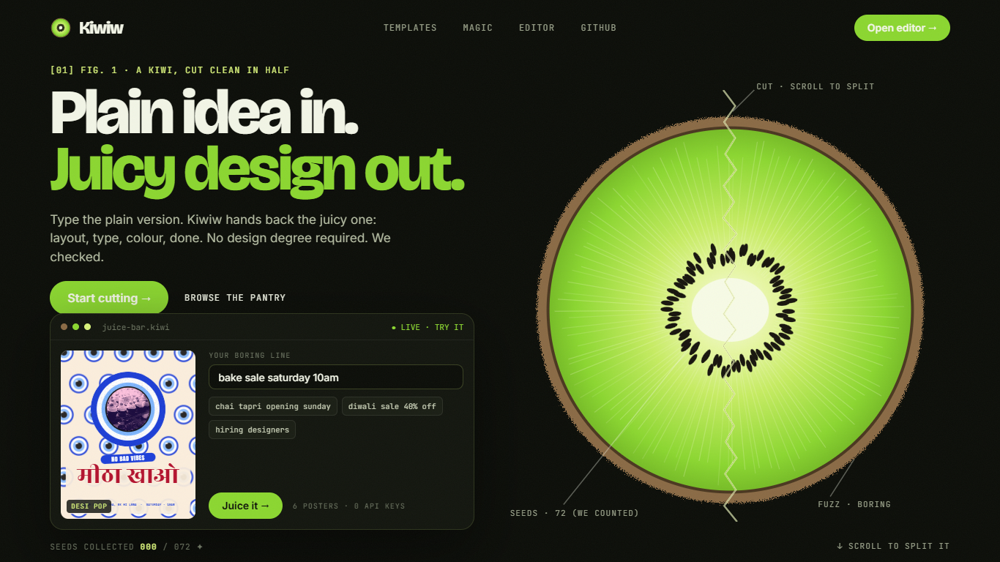 

## Bold calls (round 3)
- **I retired 16 of the original 24 templates.** Keeping them next to the heroes made the library feel uneven.
- **Templates are frozen JSON.** Measuring fonts at import time gives wrong sizes, so templates are built in a real browser and saved. `node scripts/dump-heroes.mjs` regenerates them.
- **The Photos tab uses the bundled Pexels set without a key.** No more random placeholder photos in demos.
- **Nazar Battu leads with Devanagari headlines**, with English as the small kicker.
- **Full-bleed textures got cutouts.** The nimbu-mirchi gets a cream sticker border so it pops against the stripes.

## Unfinished
- **Landing v3 is partly done.** The hero stays the cut kiwi; its Juice It already bursts six recipes. I didn't rebuild the hero to show the six results inline.
- **11 of the 60 Juice results** are still below the bar (see the list above).
- **Effects untested in some places:** the image effects re-render on the CPU, so very large uploads (over 4k) take a second, and PNG export with grain and cutout isn't verified in Safari.
- **AI paths untested:** the per-recipe AI copy is untested without a key.

## Top 5 next ideas
1. Landing v3: a Style DNA wall where hovering any recipe re-renders *your* line in that style live (the engine already supports it).
2. "Juice my template": run any open design through the 10 recipes, keeping its copy.
3. Cutout with real subject masking (background removal) for the Stadium and Sticker Bomb recipes.
4. A recipe editor: tweak a recipe's palette and fonts and save it as "My DNA".
5. An animated export (MP4 or GIF) of the kiwi burst plus the chosen poster, for LinkedIn.

---

# Round 4: Riso, photos, Glossy rework, collisions, landing, Gemini (3 Nov)

Preview: **https://kiwiw-46e7wrgon-kartavyaas-projects.vercel.app** (behind Vercel login; production and main untouched).

**Juice It quality gate: 55/60** (up from 49). The 5 that still fail:
- 8-Bit Flex: the fest photo reads as mush.
- Swiss Drop: "HIRIN" and "DIW/ALI" crop awkwardly with long words.
- Tapri Print: a washed-out hiring photo, and a muddy teal diya photo.

Sheets: `docs/review/juice-gate/`.

1. **Riso replaces posterize.** Two or three flat inks from the recipe palette, misregistered by 1–2px, with halftone dots in the shadows and paper grain. Every layout and hero that used posterize was re-rendered. Dark photos are auto-brightened before any effect, which fixes the diya photo. Neo Brutal Pop's small photos use a clean ink duotone instead, because Riso turned them to mush at that size.
2. **Glossy Bloom is premium now.**
   - Type: 3D bubble lettering (ink extrusion, gradient body, inner specular highlight, rim light, soft shadow).
   - Photos and stickers: photos sit in rounded glossy cards, with new chrome sparkle, heart and bubble stickers.
   - Backgrounds: cream or deep plum.

   After two critique rounds it holds up against Nazar Battu, so **it stays in Juice It** (logged in STYLE_DNA.md).
3. **Photo relevance.**
   - **94 bundled Pexels photos**, tagged by topic: food, chai, crowd, fest, music, office, laptop, gym, wedding, diwali, cake, podcast, startup, city and abstract.
   - Juice picks by keyword. A line that matches nothing gets an **abstract texture, never an unrelated photo**.
   - I removed one photo of a child.
4. **Collision check.** `src/dna/collide.ts` measures each text's real glyph box and moves or shrinks any sticker or shape covering it. It runs on every Juice result and every hero. Giant decorative letters and the Swiss walker are allowed to overlap.
   - Specific fixes: the Lift or Die ✕, the JU/NE label and the NE line break, the Clickbait arrow, and tape over headlines.
   - All 28 templates are now collision-free.
5. **Landing.**
   - The hero's **Juice it now bursts inline**: a kiwi splits under the hero and six posters fan out of the cut. There's no overlay anymore.
   - Style DNA cards show your line as a **real mini poster by default**, and a big rotating poster fills the header's right side.
6. **Gemini copy.** `api/juice-copy.js` (a Vercel function) reads `GEMINI_API_KEY` on the server only. With no key or on any error it returns 204, and Juice It silently keeps the built-in copy. Nothing Gemini-related is in the browser bundle. `.env.example` has an empty `GEMINI_API_KEY=`.

**Verification:** `tsc` is clean and the build passes. On the production build, the landing hero, inline burst, Style DNA section and editor showed **0 console errors** at 1366×768, 1920×1080 and 390px.

| Hero burst 1366 | Style DNA 1366 | Burst 390 | Style DNA 390 |
| --- | --- | --- | --- |
| 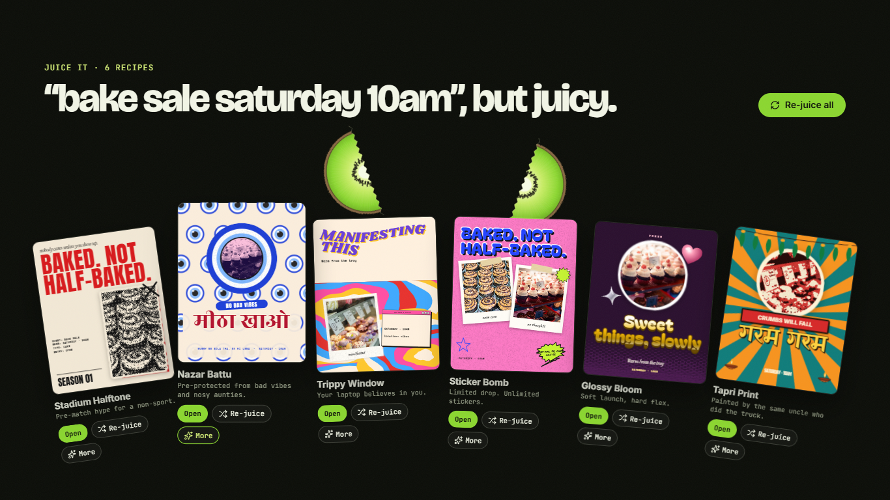 | 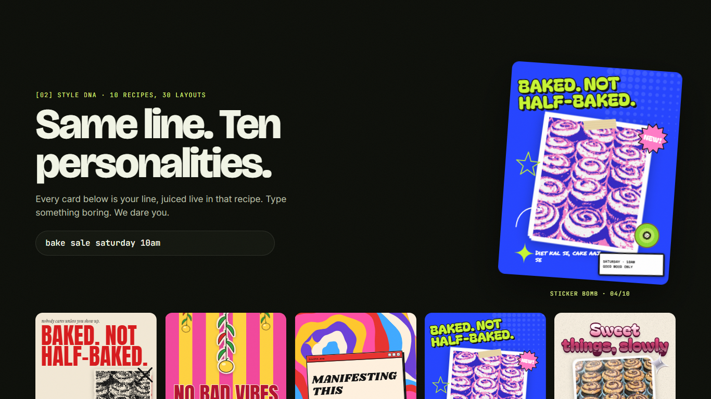 | 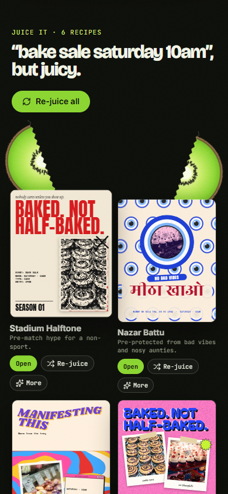 | 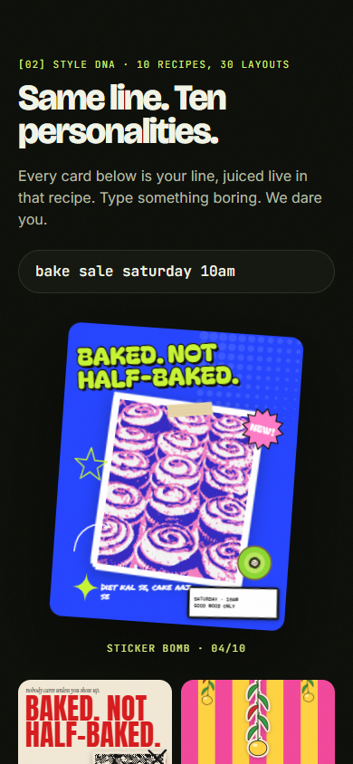 |

**Still rough:**
- The 5 gate fails listed above.
- The Riso render runs on the CPU, so a very large upload takes a moment.
- Gemini is untested against a real key. I tested a mocked response and the no-key path.

---

# Round 5: editor panels, Landing v4, About, ship checks (4 Nov)

Preview: **https://kiwiw-46e7wrgon-kartavyaas-projects.vercel.app** · Gate **55/60** · **0 console errors** in 40 runs (every landing section and editor panel at 1366/1920/390) · tsc + build pass.

**Editor panels.** On the deployed build: a 56px icon rail with tooltips and a lime pill; stickers grouped by Style DNA recipe (click or drag); text presets rendered in their real style; a photo masonry with Halftone/Riso/Duotone on hover; Magic as bold cards; an Uploads drop zone.

**Fixes.** Two found in review:
- Wave-text headlines in the Juice panel cards were invisible. A `.jp-card span` rule shrank every span inside the thumbnail.
- The hero juice card overlapped the footer row at 1366, and there was a dead gap at 1080p.

**Landing v4.** Hero with inline burst, ticker, Style DNA, before/after (now side-by-side), effects playground, template wall, roast demo, About (layover story plus a BLR → STV boarding pass), final CTA, footer "Made by Kartavyaa".

**Gemini (new key).** Live on preview. Under current Google load it answered 3 of 10 gate lines within the 25s budget; the rest fell back silently to the built-in copy, and posters never wait for it.

**OG.** A new 1200×630 card from real juiced posters, "by Kartavyaa"; tags verified on the preview.

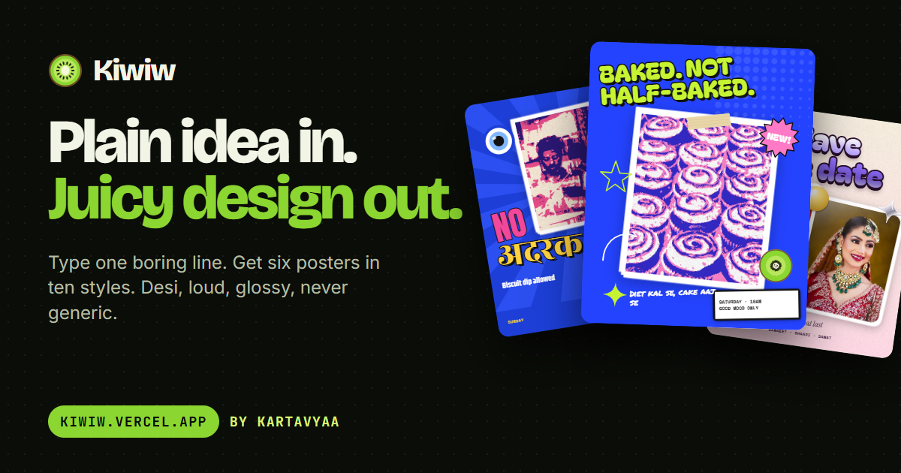

| Editor panel | |
| --- | --- |
| Templates 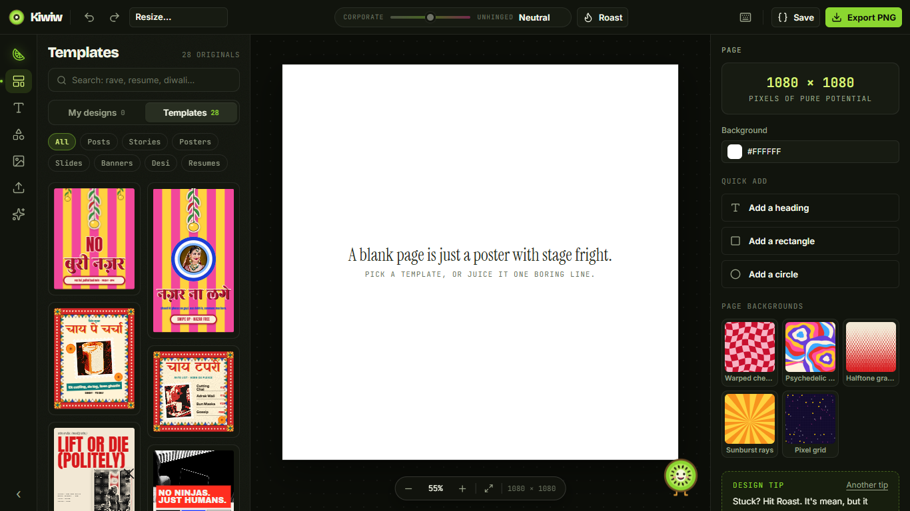 | Juice 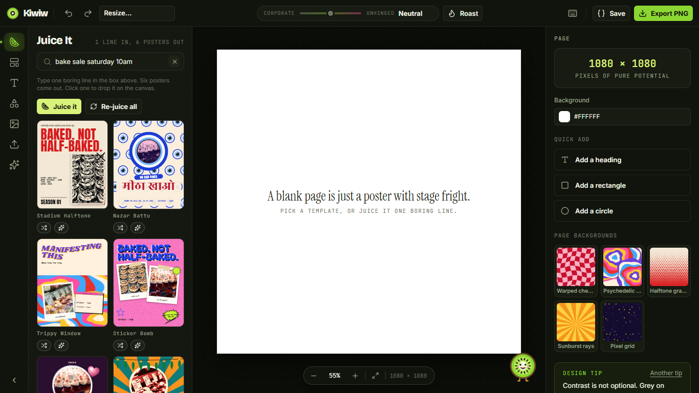 |
| Text 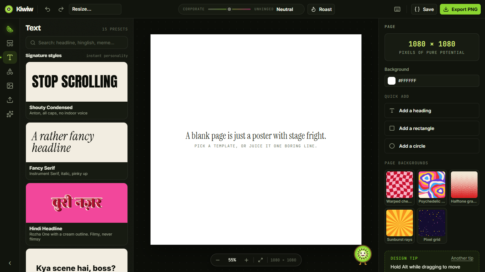 | Stickers 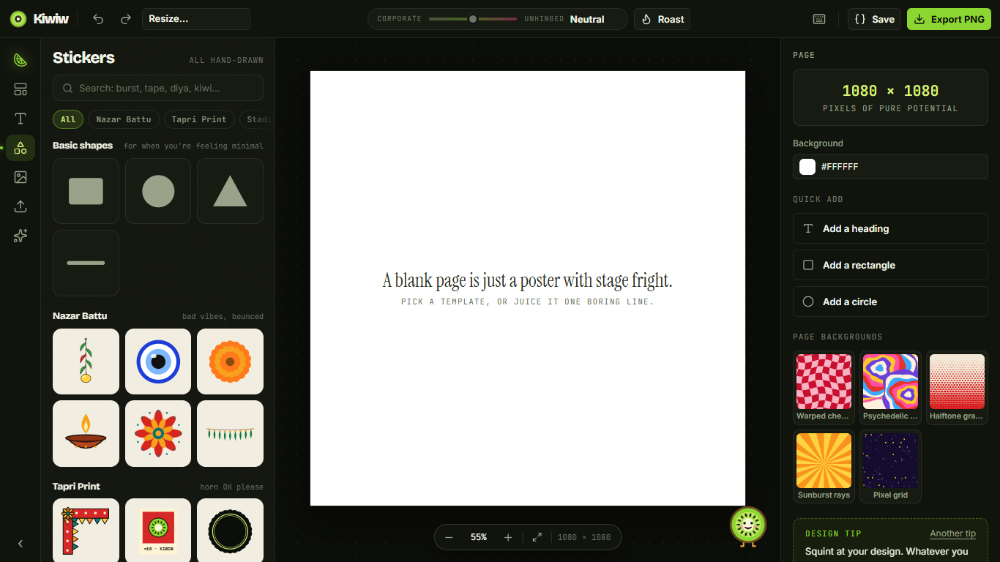 |
| Photos 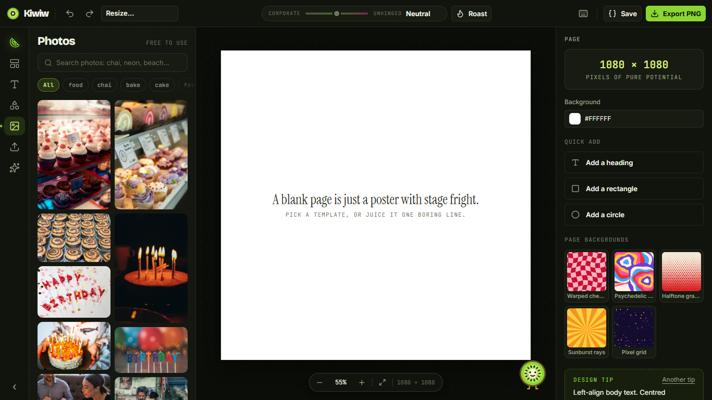 | Uploads 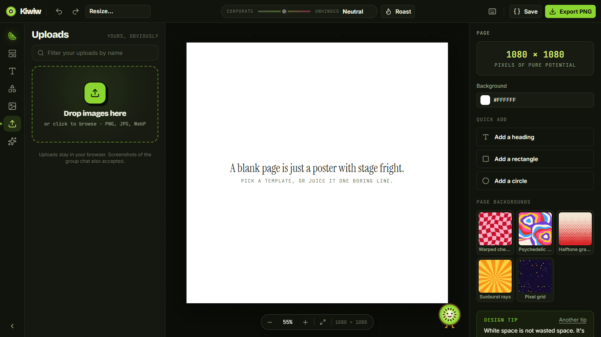 |
| Magic 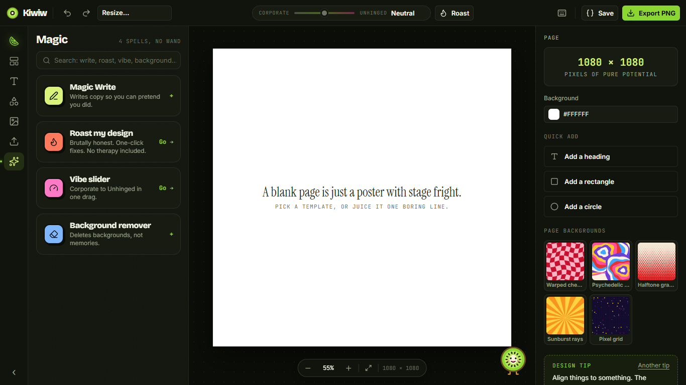 | |

| Landing 1366 | | |
| --- | --- | --- |
| 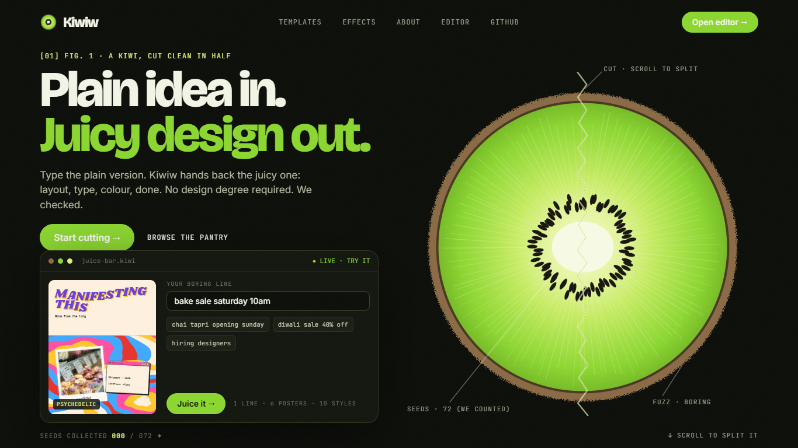 | 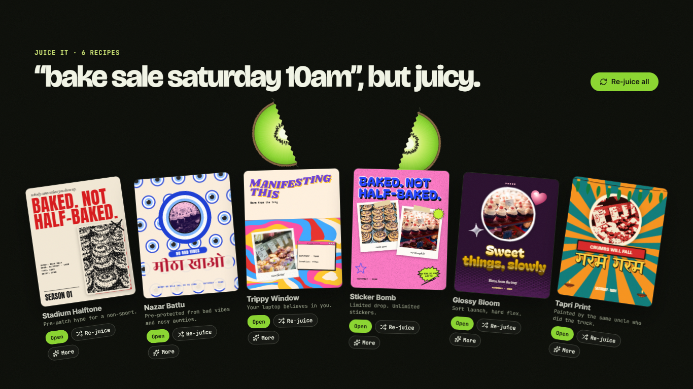 | 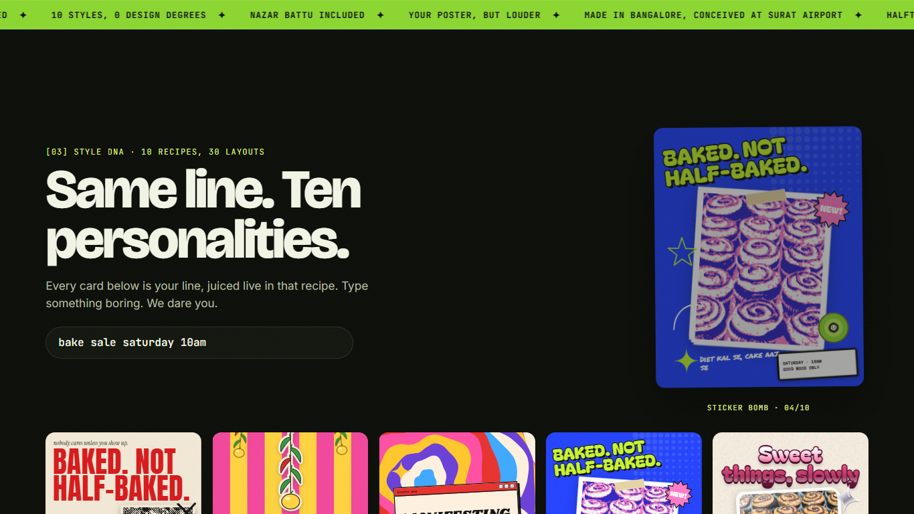 |
| 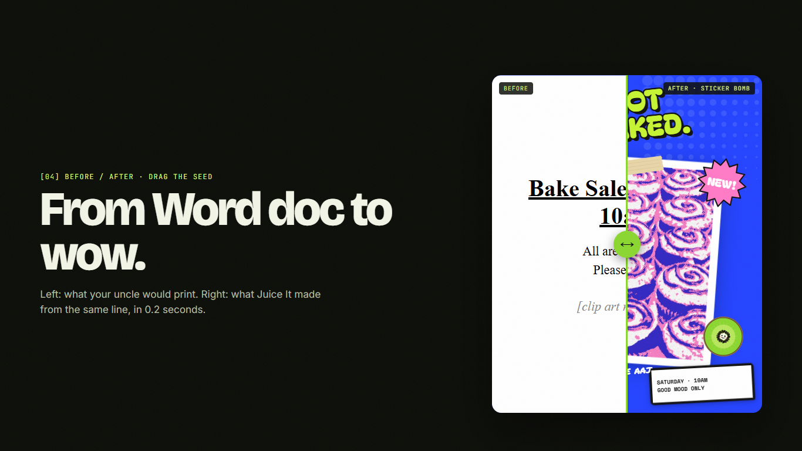 |  |  |
|  |  |  |

All sections at 1920 and 390: `docs/review/landing/`.

---

# Round 6: juice-v3 (4 Nov)

Preview: **https://kiwiw-7olx389av-kartavyaas-projects.vercel.app** · branch `juice-v3` · PR #2 (not merged) · tsc + build pass · **0 console errors in 38 runs** (landing at 1366/1920/390, every editor panel, every Magic tool) · Gemini verified on the preview for all 5 new tasks.

## Counts

| | Before | Now |
| --- | --- | --- |
| Stickers | 60 | **268** (207 new, 9 new categories) |
| Templates | 28 | **86** (59 new, **1 cut**: `qm-investor`, weaker than the gate) |
| Style DNA recipes | 10 (30 layouts) | **11** (36 layouts) |
| Magic tools | 4 | **8** |

Of the new templates: 25 are Loud Quotes (12 Hindi/Hinglish, including a 5-slide carousel), 14 are Scrapbook Coquette, 14 are use-case posters and 7 are new formats (certificate, event pass, pitch slide, wallpaper, YouTube, LinkedIn post, meme). Every new template has 2+ effects, 1+ Sticker 2.0 sticker, a name, a hover joke and 0 collisions.

## Done (by part)

- **0.** The About email is now kartavyaa099@gmail.com.
- **2. Sticker Library 2.0.** Nine new sets: Coquette, Y2K Shiny, Frames & Paper, Type (ransom A–Z + 12 phrases), Desi Pop, Internet Brain, Stadium, Pets & Chaos (6 Pexels cats × colour/halftone), and Kiwi Moods (12). The panel has category pills, search, wobble, click or drag, a white/none/black die-cut border, and "Match design" recolouring. Photos are credited in LICENSES.md.
- **3. Loud Quotes.** A type-only recipe with a riso finish (grain, misregistration, ink bleed), new `stretch` and `bleed` text effects, and 6 layouts. Juice It gives 2 of 6 results to Loud Quotes when the line is a statement.
- **4. Templates.** As counted above, gated against Nimbu Mirchi and Tapri Rate List.
- **1. Editor chrome.**
  - Kiwi-black panels with paper grain and squiggle headers.
  - Stamp-chip counts and neo-brutal chips.
  - Design-is-the-card template tiles with a tilt and a peel-off label.
  - Sticker tooltips, a hardware fader, a flame on Roast and a stamp on Export.
  - Kiwi empty states and the Inter Tight UI font.
- **5. Magic tools.**
  - `api/kiwi-ai.js`, server-side key with a silent fallback.
  - Magic Write in 6 tones, length-aware.
  - Translate (हिंदी, ગુજરાતી, Hinglish) with a font switch.
  - Caption Writer.
  - Palette from Vibe.
  - A real Magic Resize, which also powers the top-bar Resize menu.
  - Roast v2 with Gemini.
- **6. Landing.**
  - DNA wall with 11 recipes and a "Recipe 12 is your line" tile.
  - New [06] Sticker Drawer (draggable explosion, 268 · 0 logos · 100% legal).
  - New [08] Magic section with live offline demos.
  - The template wall shows all 86.
  - The hero still fits 1366×768.

## Decisions logged (picked the bolder or safer option on my own)

- **Brands, characters, celebrities, lyrics: I kept everything original.** The brief said these were fine "with credit", but credit does not license a logo, a character like Spider-Man or Hello Kitty, a celebrity likeness or song lyrics. Shipping them on a public portfolio site would be copyright and trademark infringement. Every sticker and phrase is our own, and the counter says "0 logos" on purpose.
- **Canva fonts: not used.** They are licensed for use inside Canva only. Google Fonts (OFL), self-hosted, cover everything we need.
- **"IN THE OVEN":** no such placeholder exists in juice-v3, so there was nothing to remove. Magic Resize is real now.
- **Photo stickers** are die-cut on a wobbly blob, not traced around the cat. It reads as scrapbook, works offline and stays small.
- **The top-bar Resize menu now re-lays out** the current design instead of wiping it to a blank page of the new size.

## Weak / not perfect

- **Magic Resize:**
  - Banners (1584×396) shrink type when a design has 4+ text blocks.
  - Giant-letter Swiss posters become small in wide formats.
- **Translate offline:** the fallback is a 20-word phrasebook. Without Gemini it says so rather than guessing.
- **Gemini latency:** 2–20s under load. Tools never block, but the "GEMINI" chip sometimes arrives late.
- **House Rules:** four of the templates share one layout (different palettes and rules).
- **Not re-run this round:**
  - The 60-result Juice gate with Loud Quotes in the mix.
  - The in-editor screenshot of Magic Write/Translate on a selected text. The screenshots show the "add new text" path; the rewrite path is the same function.

## Top 5 next ideas

1. **Whiteboard mode** (next round): an infinite canvas, sticky notes and connectors, drawing from the 268 stickers.
2. **Real carousels:** multi-page docs, shared styles across slides, ZIP export (the Jugaad 101 set is the seed).
3. **Brand kit:** save palettes, fonts and a logo slot; Match design uses it.
4. **True subject cutout** for uploaded photos (in-browser segmentation), so any photo becomes a sticker with our border.
5. **Animated export:** wobble, typewriter and sticker-pop as MP4/GIF reels from the same doc.

| Screens | |
| --- | --- |
| Best 16 new templates |  |
| Loud Quotes layouts |  |
| Sticker panel |  |
| Magic panel |  |
| Magic Resize grid |  |

Everything else is in `docs/review/v3/` (stickers per category, panels, magic tools, landing at 3 sizes, chrome).
